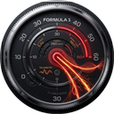
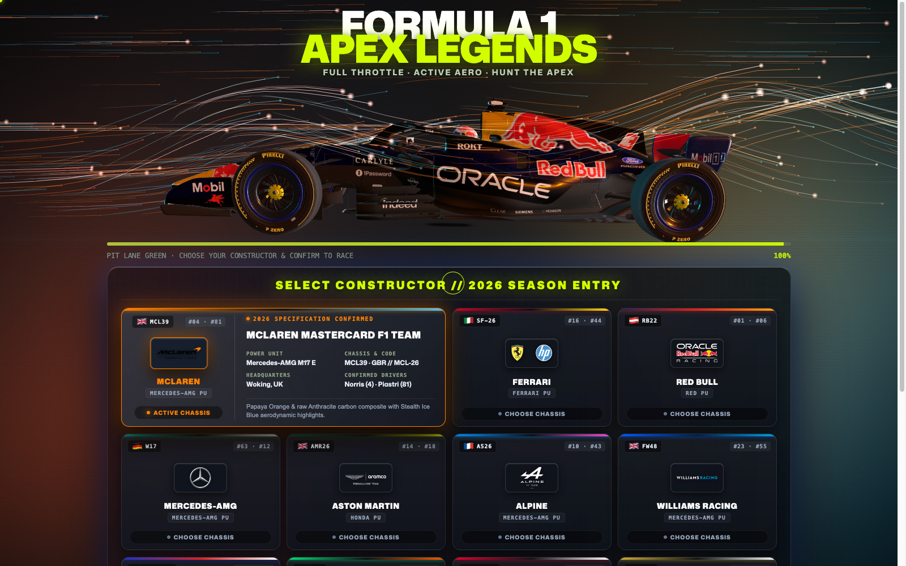
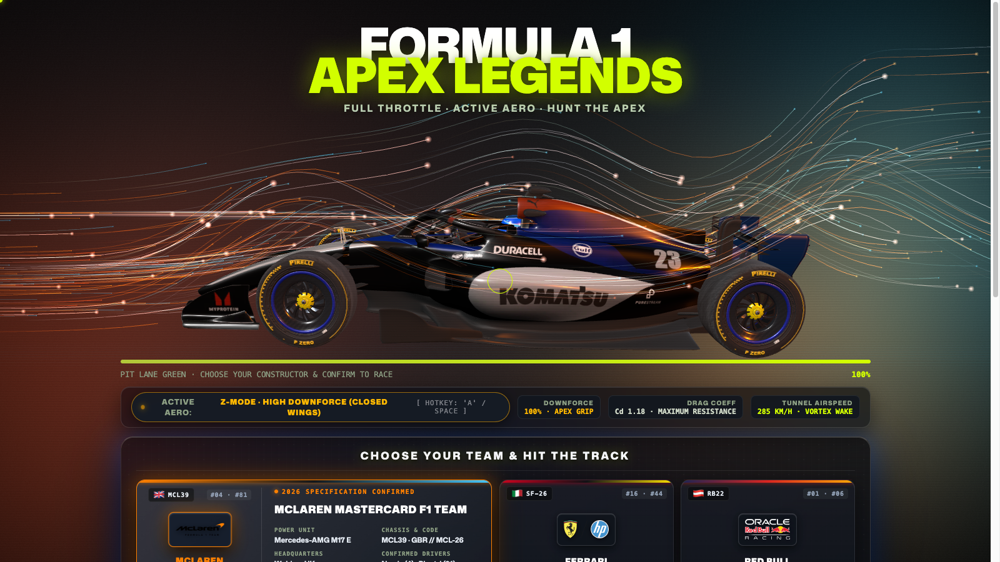
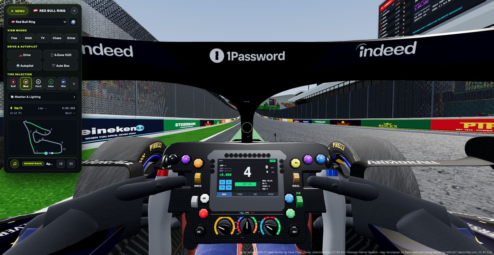
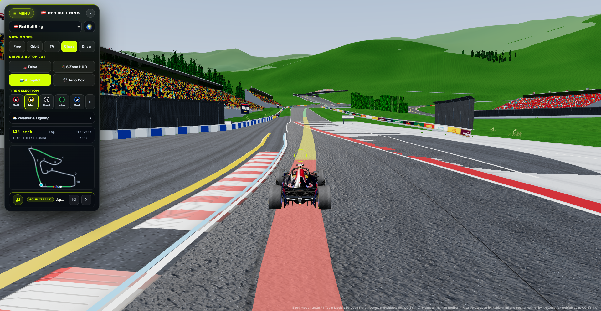
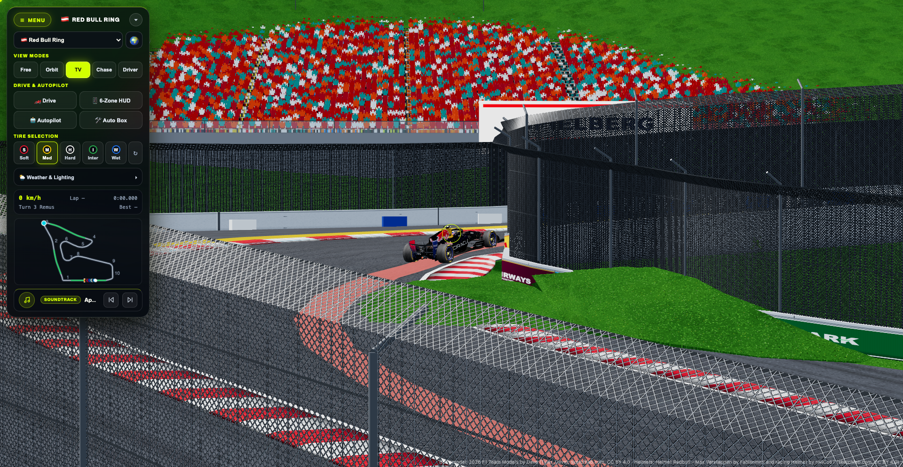
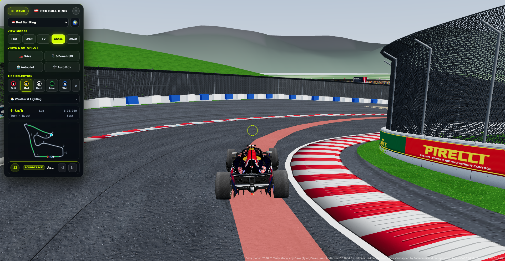
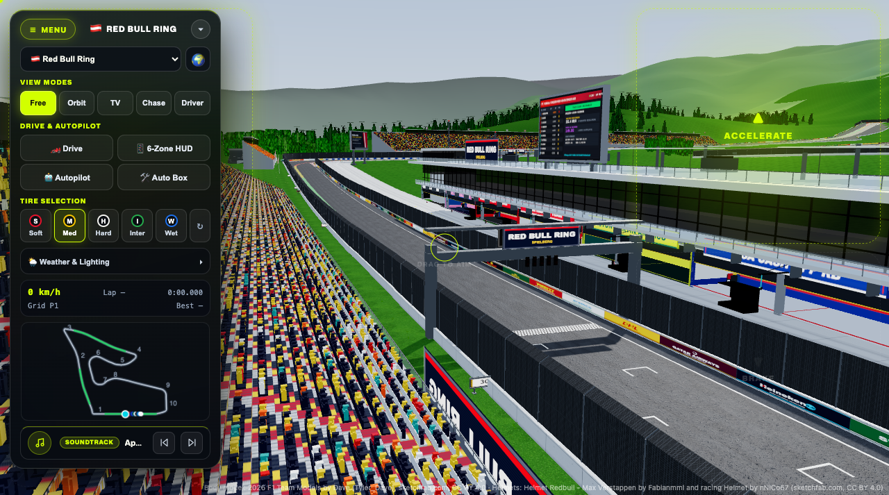
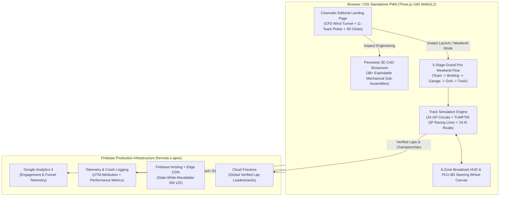

# FORMULA 1 APEX LEGENDS
### 2026 FIA "Nimble Car" 3D WebGL Digital Twin, CFD Wind Tunnel & Grand Prix Simulator

  <strong>Zero downloads. Instant browser &amp; iPhone boot.</strong> 
  Explore all <strong>11 2026 Formula 1 Constructors</strong> inside an interactive 3D CFD Wind Tunnel, actuate <strong>Z-Mode &amp; X-Mode Active Aerodynamics</strong>, inspect <strong>38+ mechanical assemblies</strong>, and race <strong>24 international Grand Prix circuits</strong> calculated via TUMFTM minimum-curvature quadratic programming.

[▶️ **Launch Live Web App**](https://formula-1-apex.web.app/?utm_source=github&utm_medium=showcase_repo&utm_campaign=quick_links) · [📐 **6-Phase Technical Roadmap**](./ROADMAP.md) · [🤝 **Co-Developer Guide**](./CONTRIBUTING.md) · [💼 **Investor & Sponsor Pitch Deck**](./FUNDING_AND_PITCH.md) · [🐞 **Report Feedback / Bug**](https://github.com/SREphoto/Formula-1-Apex-Legends/issues/new?template=feedback-and-bug-report.yml)

---

> [!IMPORTANT]
> **About This Public Showcase & Community Hub**
> The proprietary 3D CAD engine, WebGL physics runtime, and asset pipeline are maintained in our private engineering repository (`SREphoto/2026-F1-Nimble-Car`), while the **live production build is publicly playable at [formula-1-apex.web.app](https://formula-1-apex.web.app/?utm_source=github&utm_medium=showcase_repo&utm_campaign=callout_box)**.
>
> This public repository serves as our **Technical Showcase, Open Roadmap, Co-Developer Recruitment Portal, and Funding/Sponsorship Hub**. Approved co-developers receive collaborator access to the private engineering codebase.

---

## 📸 Visual Tour & Live Simulator Capabilities

### 1. Real-Time 3D CFD Wind Tunnel & 2026 Constructor Selector
Select any of the **11 confirmed 2026 Formula 1 Teams** (McLaren, Ferrari, Red Bull, Mercedes-AMG, Aston Martin, Alpine, Williams, Racing Bulls, Haas, Audi, and Cadillac). Toggle **Z-Mode (High Downforce)** and **X-Mode (Low-Drag Straight-Line Override)** in real time while inspecting GPU-accelerated aerodynamic flow streamlines, downforce coefficients, and vortex wake behavior.

---

### 2. Authentic Onboard Cockpit & Live PCU-8D Steering Wheel LCD Telemetry
Experience true Driver Eye / Halo POV with a dynamic **512×384 Canvas2D PCU-8D steering wheel display** rendering real-time gear, RPM LED shift lights, 4-corner brake/tire temperatures (`FL`, `FR`, `RL`, `RR`), MGU-K 350 kW battery State of Charge (`BATT %`), brake balance (`BBAL`), and active aero status (`Z-MODE` / `X-MODE`).

---

### 3. 24 Global Grand Prix Circuits & TUMFTM Minimum-Curvature Racing Lines
Race across **24 international Formula 1 circuits** built with 3D elevation profiles, FIA apex kerbs, catch fencing, DRS/X-Mode zones, pit buildings, and packed stadium grandstands. Enable the **AI Autopilot** or dynamic **3D Speed-Colored Racing Line Ribbon** solved via minimum-curvature Quadratic Programming (`OSQP`).

| Turn 1 Niki Lauda Kurve (Chase Cam @ 134 km/h) | Turn 3 Remus Hairpin (Broadcast TV Cam) |
| :---: | :---: |
|  |  |
| **Turn 4 Apex Kerbs & Racing Line Ribbon** | **Aerial Free-Cam & Mobile Touch Flight Mode** |
|  |  |

---

## ⚙️ 2026 FIA "Nimble Car" Technical Specification Matrix

The 2026 FIA Technical Regulations represent the most radical chassis, aerodynamic, and power-unit transformation in modern Formula 1 history. **Formula 1 Apex Legends** models these exact regulation parameters:

| Regulation Parameter | 2022–2025 Ground-Effect Era | 2026 FIA "Nimble Car" Spec (Simulated) | Engineering Impact in Simulator |
| :--- | :--- | :--- | :--- |
| **Wheelbase** | `3,600 mm` | **`3,400 mm` (`-200 mm`)** | Sharper yaw response & tighter hairpin rotation |
| **Overall Track Width** | `2,000 mm` | **`1,900 mm` (`-100 mm`)** | More room for wheel-to-wheel overtaking |
| **Minimum Dry Mass** | `798 kg` | **`768 kg` (`-30 kg`)** | Faster transient weight transfer & braking |
| **Active Aerodynamics** | Rear-wing DRS only | **Synchronized Front + Rear Active Flaps (`Z-Mode` & `X-Mode`)** | `-55%` straight-line drag in X-Mode; high cornering load in Z-Mode |
| **Power Unit Split** | ~85% ICE / ~15% MGU-K (`120 kW`) | **50% ICE (`400 kW`) / 50% Electric MGU-K (`350 kW`)** | `~300%` electrical boost + Manual Override Mode (`MOM`) up to `355 km/h` |
| **MGU-H & Turbocharger** | MGU-H fitted | **MGU-H Removed** | Direct MGU-K regeneration (`8.5 MJ/lap` harvest limit) & energy clipping management |
| **Pirelli 18" Tires** | `305 mm` Front / `405 mm` Rear | **`280 mm` Front / `375 mm` Rear (`-25 mm` / `-30 mm`)** | Reduced parasitic frontal area & refined contact-patch slip dynamics |

---

## 🏗️ System Architecture & Real-Time Pipeline

---

## 🤝 Call for Co-Developers & Engineering Contributors

We are actively expanding **Formula 1 Apex Legends** from an interactive 3D showcase and kinematic track simulator into the premier browser- and mobile-native **2026 Formula 1 Physics & Strategy Platform**. We are looking for passionate **Co-Developers** across four specialized tracks:

| Track | Role / Focus Area | Key Upcoming Deliverables ([See Full Roadmap](./ROADMAP.md)) | Stack & Skills |
| :--- | :--- | :--- | :--- |
| **Track 1** | **Vehicle Dynamics & Physics Engineer** | Upgrade kinematic bicycle model to a **4-Wheel Dynamic Rigid-Body & Pacejka Magic Formula Tire Solver**; weight transfer, curb impulse physics, tire thermal/wear degradation, and 2026 MGU-K `350 kW` harvesting/clipping curves. | JavaScript/TypeScript, Vehicle Dynamics, Numerical Integration, WebAssembly (optional) |
| **Track 2** | **3D Graphics, WebGL/WebGPU & Shader Engineer** | Custom **GLSL/WebGPU shaders** for carbon-fiber clearcoat weave, heat-reactive glowing brake discs, wet-track planar reflections, particle spray/tire smoke, and baked stadium lighting. | Three.js, GLSL Shaders, PBR Materials, Blender/glTF Optimization |
| **Track 3** | **AI Racecraft & Strategy Systems Engineer** | Multi-line AI overtaking/defending state machines, blue-flag/yellow-flag Virtual Safety Car logic, dirty-air aero wake modeling, and an interactive **Undercut/Overcut Pit Strategy Simulator**. | Game AI, Path Planning, Optimization, Real-Time Telemetry UI |
| **Track 4** | **iOS / Mobile & Hardware Input Engineer** | Native **iOS/iPadOS wrapper (Swift/WebKit)**, CoreHaptics kerb/engine vibration, Gamepad API & DirectInput steering wheel force-feedback (`FFB`), and WebAudio spatial F1 engine synthesis. | Swift / iOS PWA, WebAudio API, Gamepad / Force-Feedback APIs |

### How to Apply as a Co-Developer
1. **[Open a Co-Developer Application Issue](https://github.com/SREphoto/Formula-1-Apex-Legends/issues/new?template=co-developer-application.yml)** selecting your preferred track and sharing links to your GitHub, portfolio, or past projects.
2. Read our **[Co-Developer & Contributor Guide (`CONTRIBUTING.md`)](./CONTRIBUTING.md)** for details on our modular architecture and how collaborator access to the private `SREphoto/2026-F1-Nimble-Car` repository is granted.

---

## 🚀 Funding, Sponsorship & Strategic Partnerships

**Formula 1 Apex Legends** combines the viral accessibility of instant WebGL/mobile gaming with deep educational STEM & motorsport engineering fidelity. We are currently open to:

1. **Seed / Angel Investment & Game Development Grants** — Accelerating our 6-phase physics, multi-circuit environment art, and multiplayer telemetry roadmap.
2. **Title & In-Game Brand Sponsorships** — Authentic trackside gantry signage, showroom wind-tunnel branding, and constructor/telemetry presentation partnerships inside [formula-1-apex.web.app](https://formula-1-apex.web.app/?utm_source=github&utm_medium=showcase_repo&utm_campaign=funding_section).
3. **GitHub Sponsors & Community Backing** — Directly supporting cloud hosting, 3D asset licensing, and open educational motorsport tools.

📄 **[Read the Complete Funding & Investor Pitch Deck (`FUNDING_AND_PITCH.md`)](./FUNDING_AND_PITCH.md)**
📬 **[Submit a Funding or Sponsorship Inquiry](https://github.com/SREphoto/Formula-1-Apex-Legends/issues/new?template=funding-and-sponsorship.yml)**

---

## 🗺️ 6-Phase Engineering Roadmap Summary

Our complete engineering roadmap is documented in **[`ROADMAP.md`](./ROADMAP.md)**:

- **Phase 0 (Quick Wins & High-Impact Polish):** Instant startup asset streaming, dynamic engine audio harmonics, clean vs. dirty grid launch grip, brake rotor thermal glow, and AI difficulty scalar.
- **Phase 1 (4-Wheel Dynamic Physics & Surface Grip):** 4-corner suspension load transfer, Pacejka slip-angle/slip-ratio tire model, off-line tire marbles penalty, and compound thermal degradation (`Soft` / `Medium` / `Hard` / `Inter` / `Wet`).
- **Phase 2 (2026 FIA Hybrid Power Unit & Active Aero Rules):** Authentic `350 kW` MGU-K deployment, `8.5 MJ/lap` regenerative braking harvest, super-clipping on straights, automated X-Mode zone lockouts, and Manual Override Mode (`MOM`).
- **Phase 3 (Clean vs. Dirty Air Wake & Multi-Severity Damage):** Turbulent wake downforce loss (`15–35%` in corners) with straight-line slipstream tow (`10–18%` drag reduction), plus 3-tier mechanical & wing damage requiring pit repairs.
- **Phase 4 (Interactive Race Strategy Simulator & AI Racecraft):** Live stint degradation planner, undercut/overcut delta predictor, dynamic weather transitions, and multi-line AI overtaking/defending.
- **Phase 5 (24-Race World Championship Progression):** Persistent Driver & Constructor Championship standings, R&D tech-tree upgrades, and FIA Super Licence progression tiers.

---

## 📬 Contact & Links

- **Creator & Lead Architect:** Samuel R. Erwin III ([**SREdesigns.com**](https://sredesigns.com) · [`@SREphoto`](https://github.com/SREphoto))
- **Live Production Simulator:** [**https://formula-1-apex.web.app**](https://formula-1-apex.web.app/?utm_source=github&utm_medium=showcase_repo&utm_campaign=footer)
- **Co-Developer Applications:** [**Apply via GitHub Issues**](https://github.com/SREphoto/Formula-1-Apex-Legends/issues/new?template=co-developer-application.yml)
- **Funding & Sponsorship Inquiries:** [**Open a Sponsorship Inquiry**](https://github.com/SREphoto/Formula-1-Apex-Legends/issues/new?template=funding-and-sponsorship.yml)

---

  © 2026 Samuel R. Erwin III / SREdesigns. Built with Three.js, procedural 3D CAD, and Firebase. This project is an independent engineering visualization and racing simulator inspired by the 2026 FIA Formula 1 Technical Regulations and is not affiliated with Formula One World Championship Limited.

