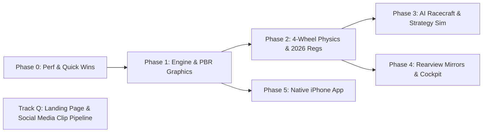

# 🗺️ Formula 1 Apex Legends — 6-Phase Engineering Roadmap & Action Plan

**Live Production Web App:** [https://formula-1-apex.web.app](https://formula-1-apex.web.app/?utm_source=github&utm_medium=roadmap_md&utm_campaign=header)  
**Apply as a Co-Developer:** [Open a Co-Developer Application](https://github.com/SREphoto/Formula-1-Apex-Legends/issues/new?template=co-developer-application.yml)  
**Sponsor / Fund a Milestone:** [Read our Funding & Pitch Deck](./FUNDING_AND_PITCH.md)

---

## Executive Architecture Overview

**Current Production Baseline (`v16` Live on Firebase Hosting & Cloud Firestore):**
- **Engine:** Native ES6 + **Three.js WebGL2** running at 60 FPS on Desktop and iOS Standalone Landscape PWA.
- **3D Assets & Digital Twin:** 11 confirmed 2026 Formula 1 Constructors with custom `.glb` liveries, 38+ explodable mechanical sub-assemblies, interactive 3D CFD Wind Tunnel (`Z-Mode` & `X-Mode`), and 24 international Grand Prix circuits with TUMFTM minimum-curvature quadratic-programming racing lines.
- **Next Major Evolution:** Transitioning from our kinematic bicycle physics and pure-pursuit autopilot to a full **4-Wheel Dynamic Rigid-Body & Pacejka Magic Formula Physics Engine**, authentic **2026 FIA `350 kW` MGU-K Energy/Clipping & Active Aero Rules**, **Clean vs. Dirty Air Wake**, **Multi-Line AI Racecraft**, and a **24-Race Season Career Progression**.

---

## ⚡ Quick Wins (Immediate High-Impact Deliverables)

| # | Quick Win Deliverable | Focus Area | Effort | Engineering Status / Impact |
|---|---|---|---|---|
| **QW1** | FPS / frame-time / draw-call telemetry overlay | Performance | ½ day | Uses `renderer.info` + Firestore `telemetry_logs` |
| **QW2** | Startup & Runtime Perf: deferred `.glb`/`.mp3` loading, pixel-ratio cap, instanced trackside geometry | Performance | 2–3 days | ✅ **Startup bottleneck fixes & SW `v22` deployed live** |
| **QW3** | Working cockpit rearview mirrors (`WebGLRenderTarget` updated every 2nd frame) | Cockpit Immersion | 1–2 days | Independent of 4-wheel physics overhaul |
| **QW4** | AI time-to-collision check → proactive braking & lateral offset in pure-pursuit controller | AI Racecraft | 2–3 days | Eliminates rear-end collisions during braking zones |
| **QW5** | Editorial landing page polish: uniform horizontal cards, scroll counters, telemetry bars | UI / UX | 1–2 days | ✅ **Deployed live (`v=2026_apex_editorial_v16`)** |
| **QW6** | Monaco Grand Prix circuit integration on the cinematic landing page | Track Pipeline | 3–5 days | Reuses TUMFTM centerline → ribbon → QP racing-line solver |
| **QW7** | iPhone Standalone Landscape PWA lock + iOS install banner + pinch-zoom guard | Mobile / iOS | 1 day | ✅ **Deployed live (`site.webmanifest` + `track_mode.js`)** |
| **QW8** | Automated 9:16 vertical social video export via headless Chrome CDP + FFmpeg | Marketing / Tools | 2–3 days | Extends `tools/test_visual_inspection.mjs` |

---

## Phase 0 — Performance Baseline & Telemetry Profiling (~1 Week)
- [x] Defer 18 MB of weekend room `.glb` assets, `.mp3` audio, and 1.7 MB `racing_lines_all.json` until user interaction; pause hidden background WebGL render loop during `#apex-loader`.
- [x] Configure Firebase Hosting CDN `stale-while-revalidate` caching headers and Service Worker `f1-apex-v22`.
- [x] Add Cloud Firestore `telemetry_logs` attribution (`utm_source`, `utm_medium`, `utm_campaign`), `car_ready` startup timing, and automated client error diagnostics.
- [ ] Add optional on-screen FPS / frame-time / draw-call HUD toggle (`renderer.info`) for desktop and iPhone Safari benchmarking.

---

## Phase 1 — Rendering Pipeline & High-Realism Graphics (~1–2 Weeks)

### 1A. Engine & WebGPU Evaluation
- [ ] Evaluate Three.js WebGPU / latest PBR pipeline vs. dedicated native export targets (`Unity` / `Godot`) for iOS App Store distribution.
- [ ] Benchmark open-source vehicle physics solvers (`Rapier`, `Jolt WASM`, custom 500 Hz RK4 Pacejka integrator).

### 1B. Lighting, Shaders & Atmospheric Realism
- [ ] **HDRI & Filmic Tone Mapping:** Physically based sky/environment lighting matched per circuit time-of-day with ACES / AgX tone mapping.
- [ ] **Baked Track Lightmaps:** Blender-baked ambient occlusion and static track shadows for near-zero runtime GPU cost.
- [ ] **Cascaded & Contact Shadows:** Sharp near-camera cascaded shadow maps + under-chassis ground-effect contact shadows.
- [ ] **PBR Car Materials:** Clearcoat + metallic flake paint (`MeshPhysicalMaterial`), procedural carbon-fiber weave, heat-glowing carbon brake rotors, and rubbered-in dark asphalt racing lines.
- [ ] **Wet Weather & Night Races:** Floodlight pools for night GPs (Las Vegas, Singapore, Bahrain), wet-track planar reflections, and rooster-tail particle spray.
- [ ] **Adaptive Quality Presets:** Auto-detected `Low` / `Medium` / `High` / `Ultra` / `iPhone 60 FPS` presets with dynamic resolution scaling.

---

## Phase 2 — 4-Wheel Dynamic Physics & 2026 FIA Technical Regulations (~6–8 Weeks)

> [!IMPORTANT]
> **Co-Developer Track 1 Focus:** Complete replacement of the kinematic bicycle model with a **500–1000 Hz sub-stepped 4-Wheel Dynamic Rigid-Body & Pacejka Tire Model**.

### 2A. 6-DOF Vehicle Dynamics & Suspension
- [ ] **6-Axis Rigid-Body Chassis:** Longitudinal, lateral, and vertical translation + yaw, pitch, and roll with authentic 2026 minimum mass (`768 kg`) and polar moment of inertia.
- [ ] **4 Independent Corners:** Springs, dampers, anti-roll bars, and ride-height bottoming out on the underfloor titanium skid plank.
- [ ] **Pacejka Magic Formula Tires:** Per-wheel slip angle ($\alpha$) and slip ratio ($\kappa$) combined traction ellipse with vertical load sensitivity.
- [ ] **Dynamic Weight Transfer:** Pitch under `5G` braking, squat under acceleration, and lateral roll through high-speed chicanes.

### 2B. Track Surface Physics, Marbles & Grid Grip
- [ ] **4-Wheel Surface Sampling:** Each tire independently queries `track.locate()` for surface type (`asphalt`, `kerb`, `runoff`, `grass`, `gravel`), banking, and gradient.
- [ ] **3D Kerb Profiles:** Flat, sausage, and saw-tooth apex kerbs that impart vertical suspension impulses and unsettle chassis balance.
- [ ] **Off-Line Tire Marbles:** Shed rubber pellets accumulate outside the main racing groove (`|lateralOffset| > 2.8 m`), causing temporary multi-corner grip loss (`18–25%`) when picked up.
- [ ] **Clean vs. Dirty Grid Slots:** Pole position (odd grid slots on the rubbered racing line) receives `1.00×` launch grip vs. `0.91×` on the dusty off-line even grid slots.

### 2C. Tire Compounds, Thermal Windows & Degradation
- [ ] **5 Pirelli 18" Compounds:** `Soft (C5)`, `Medium (C3)`, `Hard (C1)`, `Intermediate`, and `Full Wet`, each with distinct peak friction $\mu_0$, optimal thermal window (`85°C–115°C`), and wear rate.
- [ ] **Per-Corner Sliding Energy Wear:** Front-left wears fastest on clockwise circuits; locks-ups create flat spots and vibration; exceeding thermal limits triggers graining/blistering and the "grip cliff".

### 2D. Clean Air vs. Dirty Air Turbulent Wake
- [ ] **3D Wake Cone:** Trailing within `0–1.5 s` (`8–45 m`) behind a rival car inside the wake cone reduces front-axle downforce by `15–35%` (inducing thermal understeer and accelerated tire wear) while reducing straight-line drag by `10–18%` (slipstream tow).

### 2E. Collisions, Component Damage & Safety Cues
- [ ] **Multi-Zone Collision Hulls:** Separate contact zones for front wing endplates, open wheels, sidepods, underfloor, and rear wing.
- [ ] **3-Tier Mechanical & Aero Damage:**
  - *Minor (`< 12 m/s`Δv):* Wing endplate scrape (`-6%` front downforce) + titanium spark shower.
  - *Moderate (`12–28 m/s`Δv):* Broken front-wing flap (`-25%` front downforce, steering pull) requiring a `3.2 s` pit-stop nose change.
  - *Terminal (`> 28 m/s`Δv):* Suspension wishbone failure or tire puncture → DNF / Safety Car deployment.

### 2F. 2026 FIA Hybrid Power Unit, Battery Harvesting & Clipping
- [ ] **50/50 ICE + Electric Split:** `400 kW` (~536 hp) 1.6L V6 Turbo on 100% sustainable fuel + `350 kW` (~470 hp) MGU-K electric motor (MGU-H removed).
- [ ] **State of Charge (`4.0 MJ` ΔSoC) & `8.5 MJ/lap` Harvest Limit:** Energy regeneration under braking, lift-and-coast, and partial throttle.
- [ ] **2026 Speed Taper & Super-Clipping:** Standard MGU-K deployment tapers above `290 km/h` to `0 kW` at `345 km/h`; depleting SoC early on long straights triggers **power clipping** (sudden `~120+ hp` drop).
- [ ] **Manual Override Mode (`MOM`):** When within `< 1.0 s` of the car ahead at detection, unlocks full `350 kW` up to `337 km/h` (tapering to `355 km/h`).

### 2G. 2026 Active Aerodynamics (`Z-Mode` & `X-Mode`)
- [ ] **Synchronized Front + Rear Active Flaps:**
  - **Z-Mode (Default Cornering Mode):** Flaps closed (`100%` downforce, $C_d = 1.18$).
  - **X-Mode (Low-Drag Straight Mode):** Flaps open in designated FIA activation zones (`-55%` aerodynamic drag, $C_d = 0.72$, `-45%` downforce).
- [ ] **Automated Safety Interlocks:** Instant `150 ms` snap-back to Z-Mode upon brake pedal application (`> 5%`), steering angle (`> 8°`), lateral G (`> 1.2G`), or wet-track lockouts.

---

## Phase 3 — AI Drivers, Race Control & Strategy Simulator (~4–5 Weeks)

### 3A–3D. Multi-Line AI Racecraft
- [ ] **Spatial Awareness & Predictive Collision Avoidance:** 1–2 second forward trajectory projection across all 20 grid cars.
- [ ] **Overtaking & Defending State Machine:** Slipstream pull-out, inside defensive cover (1-move FIA rule), late-braking corner dives, and switchback maneuvers.
- [ ] **AI Tire & Energy Management:** AI rivals dynamically manage battery SoC and pit strategies based on tire degradation and dirty-air exposure.

### 3E & Research Track R. FIA Sporting Regulations & Race Control
- [ ] **Per-Circuit FIA Rules Engine (`circuits_facts.js`):** Track limits monitoring, pit-lane speed limiters (`80 km/h` / `60 km/h`), mandatory dry-compound change enforcement, and `5 s` / `10 s` time penalties.
- [ ] **Flags & Safety Car:** Yellow flag, Blue flag, Red flag, Virtual Safety Car (`VSC`), and full Safety Car (`SC`) bunching.

### Research Track S. Interactive Race Strategy Simulator
- [ ] **Pre-Race & Pit-Wall Strategy Planner:** Interactive lap-time vs. lap-number chart modeling fuel burn (`-0.032 s/lap`), compound wear curves, pit-lane loss (`~21.5 s`), and live **Undercut / Overcut Window** projections.

---

## Phase 3.5 — Gamification, Telemetry Coaching & 24-Race Season Career

- [ ] **Accessible Car Setup Studio:** Plain-language setup sliders (*"More Downforce ↔ More Top Speed"*) with live 3D wing/ride-height preview, ghost-car delta comparisons, and race-engineer radio coaching.
- [ ] **Driver Skill Tree & R&D Upgrades:** Earn XP and Constructor Championship points across a 24-race calendar to upgrade Aerodynamics, Power Unit Efficiency, Chassis Mass, and Pit Crew Speed under FIA Budget Cap & Wind-Tunnel ATR rules.

---

## Phase 4 — Cockpit Rearview Mirrors (~1 Week)
- [ ] Dual left/right rearview mirror render targets in Driver Cockpit view running at half-refresh rate (`< 2 ms` GPU budget).

---

## Phase 5 — Native iOS / iPadOS App Store Distribution
- [ ] Native iOS wrapper / engine build with **CoreHaptics** kerb & gearshift feedback, tilt/touch steering, and MFi / Bluetooth controller support targeting locked 60 FPS on iPhone.

---

## 🤝 Want to Build or Fund One of These Phases?

- **Engineers & Designers:** **[Apply to Join as a Co-Developer](https://github.com/SREphoto/Formula-1-Apex-Legends/issues/new?template=co-developer-application.yml)**
- **Investors, Grants & Brand Sponsors:** **[Submit a Funding / Sponsorship Inquiry](https://github.com/SREphoto/Formula-1-Apex-Legends/issues/new?template=funding-and-sponsorship.yml)**
